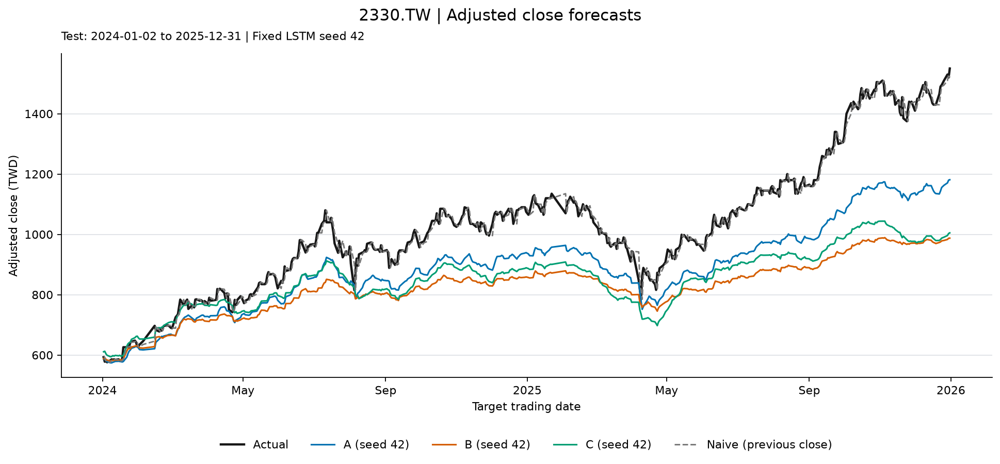
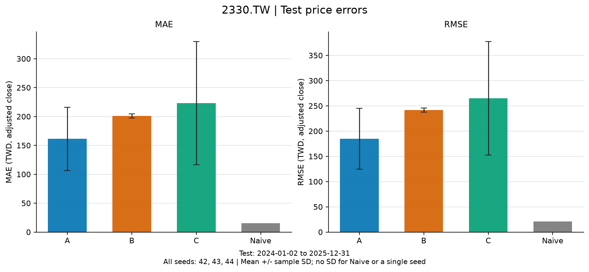

# 台積電股價趨勢預測實驗

本專案以 TWSE 台積電（2330.TW）日行情，比較 LSTM 與 GRU 對下一交易日收盤價的預測誤差。

導覽：[正式實驗結果](#正式實驗結果) · [實驗摘要](#實驗摘要) · [文件與專案結構](#文件與專案結構) · [環境、資料與執行](#環境資料與執行)

## 正式實驗結果

**結果重點**：GRU 在 A、B、C 三組特徵的平均 MAE、RMSE 都低於對應 LSTM；六組模型的誤差仍高於 Naive 基準。

本次結果不表示可獲利；每種模型設定僅有三個固定種子，未做統計顯著性檢定。價格誤差與方向準確率都不是交易報酬；本研究沒有評估交易規則、成本或投資獲利。

### 價格誤差

以下數值單位為 TWD，列出種子 42、43、44 的平均 ± 樣本標準差（ddof=1）。

| 特徵組 | 模型 | MAE | RMSE |
| --- | --- | ---: | ---: |
| A | LSTM | 161.353 ± 54.889 | 185.064 ± 60.337 |
| A | GRU | 66.508 ± 4.865 | 80.791 ± 5.657 |
| B | LSTM | 201.038 ± 3.627 | 241.934 ± 4.220 |
| B | GRU | 87.058 ± 26.663 | 105.199 ± 28.359 |
| C | LSTM | 223.412 ± 106.612 | 265.089 ± 112.647 |
| C | GRU | 181.286 ± 35.593 | 211.967 ± 37.903 |

### 三向方向準確率

以下為平均百分比 ± 百分點樣本標準差（ddof=1）；三向分類包含上漲、下跌與持平。

| 特徵組 | LSTM | GRU |
| --- | ---: | ---: |
| A | 40.14% ± 0.12 | 40.21% ± 0.00 |
| B | 40.62% ± 0.00 | 40.27% ± 0.48 |
| C | 41.51% ± 1.37 | 40.00% ± 0.00 |

### Naive 基準

Naive 以前一交易日收盤價作為預測，是同一測試集上的單次基準，沒有種子或標準差；方向準確率不適用。

| 基準 | MAE（TWD） | RMSE（TWD） |
| --- | ---: | ---: |
| 前收盤價 | 15.371 | 20.969 |

### 測試集預測圖

以下圖表來自 LSTM run，價格圖只顯示 seed 42 預測，並非 GRU 曲線。完整四張 LSTM 圖及 GRU/LSTM 分析見[正式實驗結果報告](docs/LSTM%20與%20GRU%20股價預測正式實驗結果.md)。





### 觀察

A、B、C 分別代表 Close、OHLCV、OHLCV 加技術指標，並非三種模型。兩種模型都以 A 組得到最低平均價格誤差；C 組增加技術指標後沒有改善本次誤差。GRU 的參數數比對應 LSTM 少約 23.8% 至 23.9%。本次 GRU 每組平均訓練時間較短，但兩次實驗分時段執行，且 early stopping 輪數不同，不能推論普遍速度優勢。六組模型 MAE 與 RMSE 都高於 Naive；本次單一股票、固定期間的三種子結果亦未作顯著性檢定。

### 結果檔案

- [LSTM 指標彙總](results/20261120T134010119780Z_82eaad21/evaluation/metrics_summary.csv) 與 [GRU/LSTM 比較彙總](results/gru_20261120T143901617329Z_1fa00b5e/evaluation/comparison_summary.csv)。
- [完整逐種子比較](results/gru_20261120T143901617329Z_1fa00b5e/evaluation/comparison_per_seed.csv) 與 [GRU 文字比較報告](results/gru_20261120T143901617329Z_1fa00b5e/comparison.md)。

## 實驗摘要

- 資料：TWSE 2330.TW 未還原日行情；測試目標日期為 2024-01-02 至 2025-12-31，共 485 日。
- 切分：依目標日期，訓練 2015–2022、驗證 2023、測試 2024–2025；三組共用目標日期。
- 輸入：過去 60 個交易日預測下一交易日 Close；A 為 Close，B 為 OHLCV，C 為 OHLCV 加 MA5、MA20、RSI14、MACD、MACD signal。
- 訓練：LSTM(64) 或 GRU(64) 接 Dense(1)，Adam 0.001、MSE、batch size 32、最多 100 epochs、validation loss 早停；種子 42、43、44。
- 評估：MAE、RMSE 以 TWD 計；方向以漲、跌、平三分類計。Naive 以前一交易日 Close 為預測值，方向指標為 N/A。

## 文件與專案結構

- [LSTM 與 GRU 正式實驗結果](docs/LSTM%20與%20GRU%20股價預測正式實驗結果.md)：完整比較、限制、四張 LSTM 圖與可追溯產物。
- [LSTM 特徵比較正式實驗報告](docs/單變量與多變量%20LSTM%20股票價格預測績效比較｜實驗報告.md)：LSTM 專題的詳細結果與方法。
- [研究計畫摘要](docs/單變量與多變量%20LSTM%20股票價格預測績效比較｜研究計畫摘要.md) 與 [8 個 Commit 實作計畫](docs/單變量與多變量%20LSTM%20股票價格預測績效比較｜實作計畫.md)：歷史研究設計文件。
- src/lstm_comparison/：資料、特徵、訓練、評估、報告與 CLI；configs/research.json：LSTM 研究設定；res/research/：已保存行情快照；results/：正式 run 與評估產物；tests/：自動化測試。

### 文件編排參考

本 README 的摘要、導覽與結果順序參考 [Google README 指引](https://github.com/google/styleguide/blob/gh-pages/docguide/READMEs.md)、[Google TimesFM](https://github.com/google-research/timesfm/blob/master/README.md) 與 [PyTorch](https://github.com/pytorch/pytorch/blob/main/README.md) 的文件呈現方式；本專案依需求優先展示實際結果。

## 環境、資料與執行

以下命令在 repo 根目錄的 PowerShell 執行。專案需求為 Windows x64、Python 3.11；uv.lock 固定相依版本。

### 建立環境

新 clone 可使用已安裝的 uv 建立環境並安裝鎖定依賴：

```powershell
uv sync --locked
```

若目前 repo 已有 .venv，可直接使用其 Python，不需重新安裝：

```powershell
.\.venv\Scripts\python.exe -m lstm_comparison --help
```

### 檢查與準備資料

先驗證設定。若使用已保存快照，load-snapshot 會離線讀取並核對；需要新下載時再執行 download，此命令會連線至資料來源。

```powershell
.\.venv\Scripts\python.exe -m lstm_comparison validate-config --config configs/research.json
.\.venv\Scripts\python.exe -m lstm_comparison load-snapshot --config configs/research.json
```

需要下載資料時：

```powershell
.\.venv\Scripts\python.exe -m lstm_comparison download --config configs/research.json
```

### 訓練 LSTM、評估及產生報告

run 會建立新的實驗目錄並訓練 A/B/C 三組模型；完成後以輸出的 run 路徑執行 evaluate，再用同一路徑執行 report。評估產物寫入該 run 的 evaluation/，報告和圖表寫入 report/。

```powershell
.\.venv\Scripts\python.exe -m lstm_comparison run --config configs/research.json
.\.venv\Scripts\python.exe -m lstm_comparison evaluate --run-dir <run目錄>
.\.venv\Scripts\python.exe -m lstm_comparison report --run-dir <run目錄>
```

將 <run目錄> 替換成 run 輸出顯示的實際路徑。若要重做已完成實驗，使用新 run 目錄；既有評估或報告目錄不會覆寫。

### 訓練 GRU 並讀取結果

GRU 使用獨立 module，不是主 CLI 子命令。命令會以既有 LSTM run 作為共用資料、測試目標與 scaler 基準，建立新的 GRU run：

```powershell
.\.venv\Scripts\python.exe -m lstm_comparison.gru_experiment --baseline-run-dir results/20261120T134010119780Z_82eaad21
```

命令會輸出 GRU run 目錄。完成後可在該目錄的 evaluation/ 檢視彙總與逐種子 CSV，並開啟 comparison.md 查看文字摘要。
