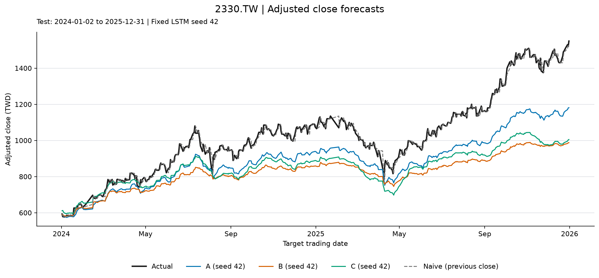
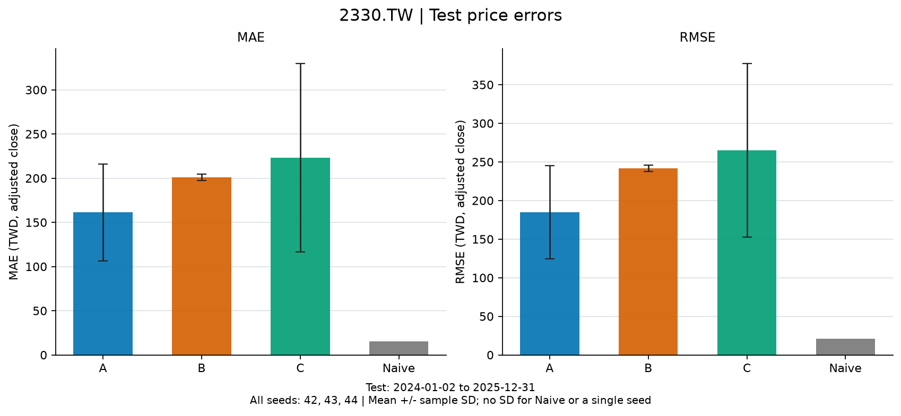
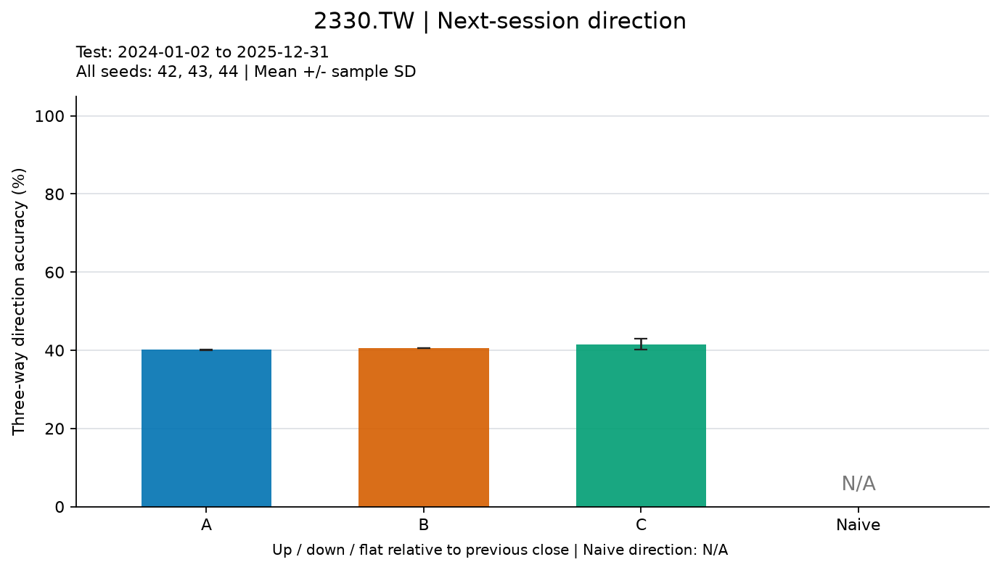
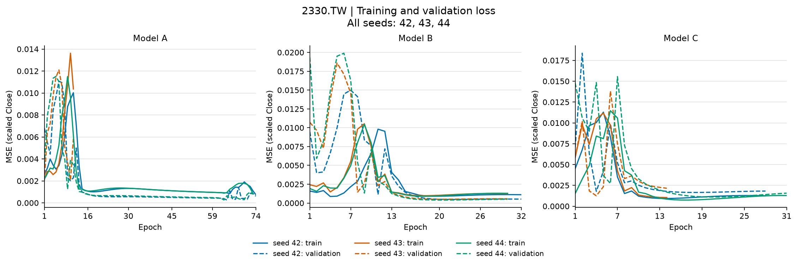

# LSTM 與 GRU 股價預測正式實驗結果

本報告比較單向 LSTM 與 GRU 對臺積電（2330.TW）下一交易日收盤價的預測。GRU 在三組特徵的平均 MAE、RMSE 均低於對應 LSTM，但所有網路模型的誤差都高於以前一交易日收盤價作為預測值的 Naive 基準。此結果不表示可獲利。

## 測試集結果

模型以種子 42、43、44 各訓練一次，表中呈現平均 ± 樣本標準差（ddof=1）。MAE、RMSE 單位為新臺幣；方向正確率是上漲、下跌、持平三分類比例，其標準差以百分點表示。Naive 是單一基準序列，沒有種子標準差。

| 特徵 | 模型 | 參數數 | 平均訓練秒數 | MAE（TWD）平均 ± 樣本 SD | RMSE（TWD）平均 ± 樣本 SD | 三向方向正確率平均 ± 樣本 SD |
| --- | --- | ---: | ---: | ---: | ---: | ---: |
| A | LSTM | 16,961 | 40.26 | 161.353 ± 54.889 | 185.064 ± 60.337 | 40.14% ± 0.12 百分點 |
| A | GRU | 12,929 | 29.48 | 66.508 ± 4.865 | 80.791 ± 5.657 | 40.21% ± 0.00 百分點 |
| B | LSTM | 17,985 | 22.10 | 201.038 ± 3.627 | 241.934 ± 4.220 | 40.62% ± 0.00 百分點 |
| B | GRU | 13,697 | 14.56 | 87.058 ± 26.663 | 105.199 ± 28.359 | 40.27% ± 0.48 百分點 |
| C | LSTM | 19,265 | 17.77 | 223.412 ± 106.612 | 265.089 ± 112.647 | 41.51% ± 1.37 百分點 |
| C | GRU | 14,657 | 14.69 | 181.286 ± 35.593 | 211.967 ± 37.903 | 40.00% ± 0.00 百分點 |
| Naive | 前一交易日 Close | — | — | 15.371（單一值） | 20.969（單一值） | N/A |

Naive 的測試集 MAE 為 15.371134 TWD、RMSE 為 20.969344 TWD。六組網路模型的平均 MAE 與 RMSE 都高於這個基準。

### LSTM 測試集圖表

以下圖表只呈現 LSTM run 的產物；價格圖固定採 seed 42，不是 GRU 預測曲線。完整模型數值比較見上表。

## 結果觀察與限制

### LSTM 特徵組

LSTM 的 A 組平均價格誤差最低；B 組及 C 組的 MAE、RMSE 均較高。C 組方向正確率平均最高（41.51%），但其價格誤差也最高，說明方向比例與價格誤差是不同指標。以本次設定而言，增加 OHLCV 或技術指標未降低 LSTM 的平均價格誤差。

### GRU 特徵組

GRU 的 A 組平均價格誤差最低；方向正確率最高的是 B 組（40.27%），其次為 A 組（40.21%），C 組為 40.00%。因此 A 組雖有最低價格誤差，並非方向正確率最高。三組 GRU 參數量均少於對應 LSTM。

### LSTM 與 GRU

以 LSTM 平均誤差為分母，GRU 在 A、B、C 組的 MAE 分別低 58.781%、56.696%、18.856%，RMSE 分別低 56.344%、56.517%、20.040%。這表示 GRU 在本次共同測試集上的價格誤差低於 LSTM，並不代表相對 Naive 有改善。

GRU 參數數比對應 LSTM 少約 23.8% 至 23.9%。兩次 run 的環境 metadata 相同（Windows、Python 3.11.18、TensorFlow CPU 2.21.0、Keras 3.15.1），但分時段執行，且各種子 early stopping 輪數不同。GRU run 記錄九次 fit 耗時合計 176.20 秒、runner 總耗時 205.87 秒；這些數字與表中的每組平均訓練秒數不同。時間僅描述本次 CPU 執行，不代表普遍速度差異。

方向正確率排序不一致：GRU 相對 LSTM 在 A 組高 0.07 百分點，在 B、C 組分別低 0.34、1.51 百分點。方向正確率是漲、跌、平三類的整體正確比例，不宜直接與二分類 50% 比較。

### 結論與研究限制

Naive 以前一交易日 Close 預測下一交易日 Close，測試集共有 485 筆。所有網路模型平均 MAE 與 RMSE 均高於 Naive；GRU 雖比 LSTM 誤差低，仍未超越持續性基準。本實驗未評估交易規則、交易成本或投資報酬，價格預測誤差不等同獲利能力。

A 組在兩種模型中都有最低平均價格誤差。增加特徵後誤差上升是本次觀察，無法由此識別特徵冗餘、尺度差異或非平穩等原因，也不作因果推論。結果來自單一股票、單一固定測試期間及每種設定三個種子；樣本標準差僅描述這三次訓練的變異，未進行統計顯著性檢定，也不能代表其他期間或標的的泛化表現。

## 實驗方法

資料來自臺灣證券交易所（TWSE）2330.TW 未還原日行情，設定期間為 2015-01-01 至 2025-12-31，目標為下一交易日 Close。依預測目標日期切分：訓練設定為 2015–2022、驗證為 2023、測試為 2024–2025。60 個交易日視窗及技術指標暖機後，各組共同樣本數為訓練 1,865、驗證 239、測試 485；測試目標日期為 2024-01-02 至 2025-12-31。期間端點是設定日期，不代表每一天都是交易日。

A 僅含 Close；B 含 Open、High、Low、Close、Volume；C 在 OHLCV 上加入 MA5、MA20、RSI14、MACD、MACD_signal（RSI 使用 Wilder 平滑，MACD 為 12/26/9）。每次以過去 60 個交易日預測下一交易日（horizon=1）。GRU 沿用 LSTM run 的特徵與目標縮放器，只執行 transform；兩組使用相同資料快照、交易日曆、特徵、測試目標日期及三個種子。

模型為單向 LSTM(64) 或 GRU(64)，各接 Dense(1)。兩者使用 Adam、learning rate 0.001、MSE、batch size 32、shuffle=False、最多 100 epochs；監看 validation loss，patience=10，並還原最佳權重。方向正確率以預測與實際的次日價格變動分為上漲、下跌、持平三類。

## 可追溯產物與重現

- LSTM run：20261120T134010119780Z_82eaad21；[設定](../results/20261120T134010119780Z_82eaad21/config.json)、[環境](../results/20261120T134010119780Z_82eaad21/environment.json)、[原 LSTM 報告](../results/20261120T134010119780Z_82eaad21/report/report.md)、[Naive 與 LSTM 指標](../results/20261120T134010119780Z_82eaad21/evaluation/metrics_summary.csv)。
- GRU run：gru_20261120T143901617329Z_1fa00b5e；[設定](../results/gru_20261120T143901617329Z_1fa00b5e/config.json)、[run manifest](../results/gru_20261120T143901617329Z_1fa00b5e/run.json)、[環境](../results/gru_20261120T143901617329Z_1fa00b5e/environment.json)、[比較報告](../results/gru_20261120T143901617329Z_1fa00b5e/comparison.md)、[逐種子比較](../results/gru_20261120T143901617329Z_1fa00b5e/evaluation/comparison_per_seed.csv)、[彙總指標](../results/gru_20261120T143901617329Z_1fa00b5e/evaluation/comparison_summary.csv)。
- [LSTM 評估報告](單變量與多變量%20LSTM%20股票價格預測績效比較｜實驗報告.md)記錄其專題方法與逐日預測來源。

若要檢查現行環境、重新訓練、評估或產生報告，請依 repo 根目錄 [README 的操作章節](../README.md#環境資料與執行)。兩個 run 的原始設定與產物保留在各自目錄。
