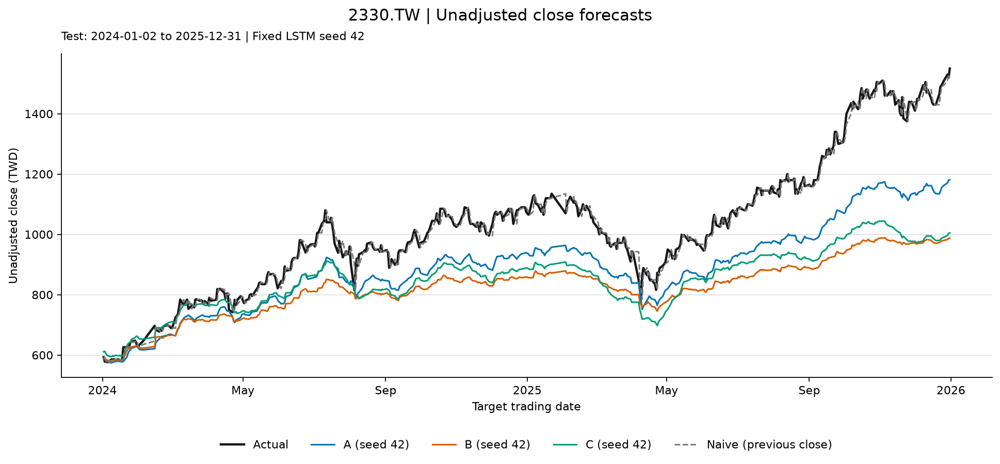
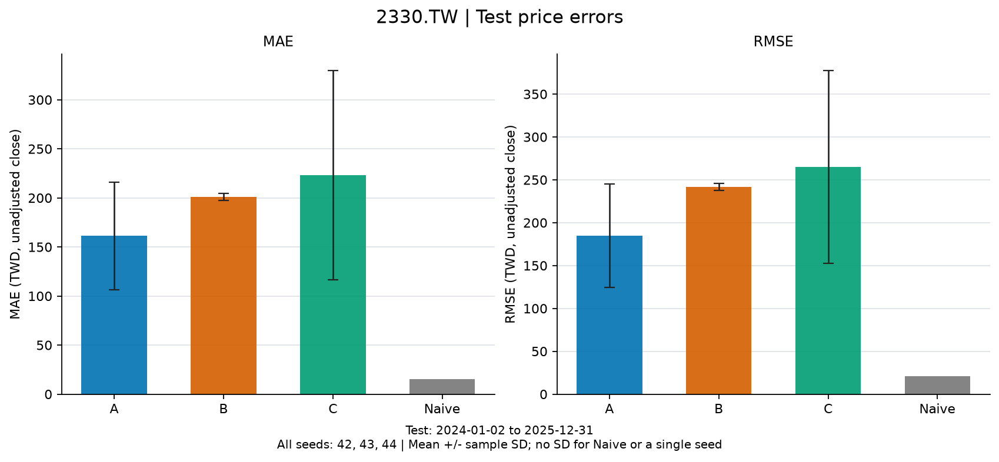
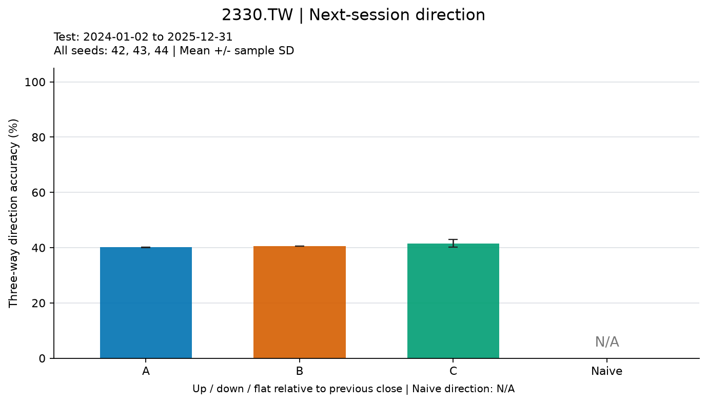
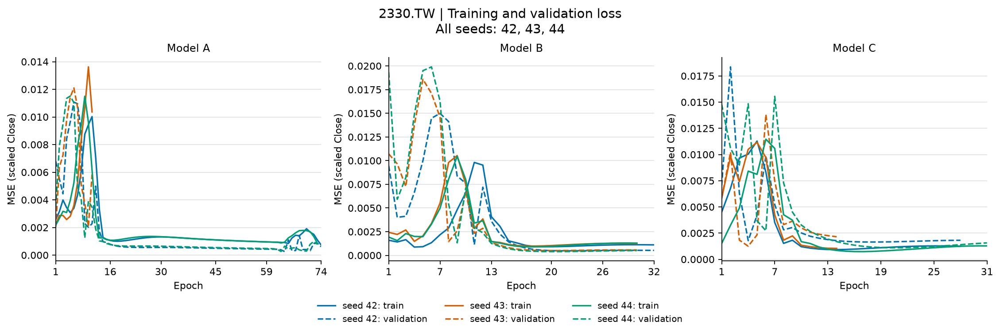

# 單變量與多變量 LSTM 股票價格預測績效比較｜正式實驗結果

本研究以臺積電 2330.TW 的 TWSE 官方未還原日行情，比較 Close、OHLCV 與 OHLCV 加技術指標三種 LSTM 輸入。正式測試集共有 485 個共同交易日；三種模型的九次訓練均完成，但 MAE 都高於以前一交易日 Close 預測的 Naive 基準，增加特徵也沒有改善本次平均 MAE。

## 研究問題與範圍

研究使用 2015-01-01 至 2025-12-31 的臺積電日行情，預測下一交易日 Close。比較重點是特徵組合對測試集預測誤差的影響，不是投資報酬或交易策略績效。

資料來自臺灣證券交易所 STOCK_DAY。凍結快照含 2,682 筆交易日資料、132 個月來源回應紀錄；價格為未還原 OHLCV，Volume 單位為股。除權息等公司行動引起的價格跳空保留在序列中，因此結果衡量名目收盤價誤差，不等於含息總報酬。

研究問題如下：

1. 使用 OHLCV 是否比只用 Close 有較低的下一日收盤價誤差？
2. 在 OHLCV 上加入移動平均、RSI 與 MACD 是否能進一步改善誤差？
3. 各 LSTM 設定能否勝過以前一交易日 Close 作為預測值的 Naive 基準？

## 方法與固定設定

| 項目 | 設定 |
| --- | --- |
| 目標 | 下一交易日未還原 Close |
| 輸入視窗 | 過去 60 個交易日，horizon 為 1 |
| 特徵 A | Close，1 欄 |
| 特徵 B | Open、High、Low、Close、Volume，5 欄 |
| 特徵 C | OHLCV 加 MA5、MA20、Wilder RSI14、MACD 與 MACD signal（12/26/9），10 欄 |
| 日期切分 | 依預測目標日期：train 2015–2022、validation 2023、test 2024–2025 |
| 縮放 | X 與 y 縮放器只用共同訓練樣本 fit；validation/test 只 transform，不裁切 |
| 模型 | 單向 LSTM(64) → Dense(1)，Adam 0.001、MSE、batch size 32、CPU、shuffle=False |
| 早停 | 只監看 val_loss，patience 10，還原最佳權重；不以 test 選種子或調參 |
| 種子 | 42、43、44；A、B、C 各訓練三次，共九次 |
| 基準 | Naive 預測值為目標日前一交易日 Close |

C 的技術指標只依當日及之前行情計算；33 筆指標暖機與 60 日視窗共同決定可用樣本。跨年度視窗保留已知歷史。三組共用相同測試目標日期、真值及前收盤。訓練共用相同網路函式，但輸入欄數不同，參數量分別為 16,961、17,985、19,265，故不是完全等參數比較。

## 正式訓練與評估完成狀態

正式實驗的 training manifest 記錄 A、B、C × seeds 42、43、44 全部 completed；每次均有訓練歷程及最佳 epoch。訓練樣本數為 1,865，validation 為 239。測試評估 manifest 記錄 485 個共同目標日，從 2024-01-02 到 2025-12-31；Naive 與九份模型預測皆使用相同日期。

| 組別 | seed 42 epochs（最佳） | seed 43 epochs（最佳） | seed 44 epochs（最佳） |
| --- | ---: | ---: | ---: |
| A | 74（64） | 11（1） | 73（63） |
| B | 32（22） | 30（20） | 30（20） |
| C | 28（18） | 14（4） | 31（21） |

## 測試集結果

MAE 與 RMSE 單位為未還原價格（TWD）；方向正確率（DA）以百分比呈現。模型彙總為三個固定種子的平均與樣本標準差（`ddof=1`）。Naive 是單一基準序列，沒有種子標準差或方向正確率。

| 組別 | MAE 平均 ± 樣本 std | RMSE 平均 ± 樣本 std | DA 平均 ± 樣本 std（%） | 相對 Naive MAE 改善率 | 相對 Naive RMSE 改善率 |
| --- | ---: | ---: | ---: | ---: | ---: |
| A | 161.353 ± 54.889 | 185.064 ± 60.337 | 40.14 ± 0.12 | -949.72%（10.50 倍誤差） | -782.54%（8.83 倍誤差） |
| B | 201.038 ± 3.627 | 241.934 ± 4.220 | 40.62 ± 0.00 | -1,207.89%（13.08 倍誤差） | -1,053.75%（11.54 倍誤差） |
| C | 223.412 ± 106.612 | 265.089 ± 112.647 | 41.51 ± 1.37 | -1,353.45%（14.53 倍誤差） | -1,164.18%（12.64 倍誤差） |
| Naive | 15.371（單一值） | 20.969（單一值） | N/A | — | — |

改善率為 `100 × (Naive 誤差 − 模型誤差) / Naive 誤差`，負值代表模型誤差較大。方向正確率不等同價格誤差或投資績效；Naive 的預測變動固定為零，依研究設計標示 N/A。

逐種子指標及 485 筆逐日預測可由 [逐種子績效 CSV](../results/20261120T134010119780Z_82eaad21/evaluation/metrics_per_seed.csv)、[彙總績效 CSV](../results/20261120T134010119780Z_82eaad21/evaluation/metrics_summary.csv)、[Naive 預測](../results/20261120T134010119780Z_82eaad21/evaluation/predictions_naive.csv)、[A seed 42](../results/20261120T134010119780Z_82eaad21/evaluation/predictions_A_seed_42.csv)、[A seed 43](../results/20261120T134010119780Z_82eaad21/evaluation/predictions_A_seed_43.csv)、[A seed 44](../results/20261120T134010119780Z_82eaad21/evaluation/predictions_A_seed_44.csv)、[B seed 42](../results/20261120T134010119780Z_82eaad21/evaluation/predictions_B_seed_42.csv)、[B seed 43](../results/20261120T134010119780Z_82eaad21/evaluation/predictions_B_seed_43.csv)、[B seed 44](../results/20261120T134010119780Z_82eaad21/evaluation/predictions_B_seed_44.csv)、[C seed 42](../results/20261120T134010119780Z_82eaad21/evaluation/predictions_C_seed_42.csv)、[C seed 43](../results/20261120T134010119780Z_82eaad21/evaluation/predictions_C_seed_43.csv) 與 [C seed 44](../results/20261120T134010119780Z_82eaad21/evaluation/predictions_C_seed_44.csv) 查閱。MAE、RMSE 與方向正確性可直接由預測 CSV 重算；報告產生流程也會重算並核對逐日誤差、每種子表、彙總表及 evaluation manifest。

## 圖表

價格圖固定使用 seed 42，未挑選最佳種子或合併 ensemble。誤差與方向圖涵蓋全部種子；loss 圖呈現各組訓練與驗證 loss。









## 研究問題的回答

**OHLCV 與單變量比較：**B 的平均 MAE 為 201.038，高於 A 的 161.353。逐種子比較中，B 有一次 MAE 較低、兩次較高；本次結果未顯示加入 OHLCV 改善平均 MAE。

**技術指標的影響：**C 的平均 MAE 為 223.412，高於 B 的 201.038。C 在兩個種子的 MAE 較低，在一個種子較高；平均表現仍未改善，且種子結果有差異。

**與 Naive 比較：**A、B、C 的平均 MAE 分別約為 Naive 的 10.50、13.08、14.53 倍。九次模型結果的 MAE 均高於同期間 Naive。就這組股票、期間、模型與固定設定而言，三組 LSTM 均未勝過 Naive。

## 限制

- 單一股票與固定期間的結果不能推廣為其他股票或期間的表現。
- 僅有三個固定種子；平均與樣本標準差描述本次訓練差異，不是市場母體的信賴區間，也未進行統計顯著性檢定。
- 各組特徵欄數不同，因此模型參數量也不同，觀察到的差異不能全部歸因於特徵內容。
- 未還原價格保留除權息等公司行動造成的跳空；此研究衡量名目 Close 預測誤差，不代表含息報酬、獲利能力或交易策略績效。

## 重現與產物來源

正式設定、來源快照、環境與階段 manifest 可由下列檔案追溯：

- [正式 run 設定](../results/20261120T134010119780Z_82eaad21/config.json)、[訓練 manifest](../results/20261120T134010119780Z_82eaad21/run.json) 與 [評估 manifest](../results/20261120T134010119780Z_82eaad21/evaluation/evaluation.json)。
- [TWSE 資料與日曆 metadata](../results/20261120T134010119780Z_82eaad21/snapshot.metadata.json)、[行情 CSV](../res/research/2330.TW_2015-2025_twse.csv) 及 [交易日 CSV](../res/research/2330.TW_2015-2025_twse.sessions.csv)。
- [訓練環境](../results/20261120T134010119780Z_82eaad21/environment.json)、[評估環境](../results/20261120T134010119780Z_82eaad21/evaluation/environment.json) 與 [報告 manifest](../results/20261120T134010119780Z_82eaad21/report/report.json)。

此 run 的 manifest 保存原始檔案位元組 SHA256。為了讓新 clone 保持這些 hash，`.gitattributes` 只對此 run 固定 JSON／Markdown 為 CRLF、CSV 為 LF，並將 PNG 視為 binary；不改寫研究數據或其他結果目錄。

從 repo 根目錄執行以下命令，可在 TEMP 副本重新產生 Markdown 報告及四張圖：

```powershell
$sourceRun = 'results/20261120T134010119780Z_82eaad21'
$tempRun = Join-Path $env:TEMP ("lstm-2330-report-" + [guid]::NewGuid().ToString('N'))
New-Item -ItemType Directory -Path $tempRun | Out-Null
Copy-Item -Path (Join-Path $sourceRun '*') -Destination $tempRun -Recurse
Get-ChildItem -LiteralPath $tempRun -Recurse -File |
    Where-Object { $_.Name -like '*.weights.h5' -or $_.Name -like '*.pkl' } |
    Remove-Item -Force
Remove-Item -LiteralPath (Join-Path $tempRun 'report') -Recurse -Force
$env:MPLCONFIGDIR = Join-Path (Get-Location) '.tools/matplotlib'
.\.venv\Scripts\python.exe -m lstm_comparison report --run-dir $tempRun
```

此流程只在 TEMP 副本重生報告，不讀模型權重、pickle 或原始行情；原始 run 的 `report` 目錄會保留。該 CLI 固定輸出到 `<run-dir>/report`，若目錄已存在會拒絕覆寫。

目前本機原 run 有被 Git 忽略的權重及縮放器 pickle；若需重新評估模型，必須使用這些檔案，並在一份尚無 `evaluation/` 的新 run 副本上執行，既有 evaluation 目錄不會覆寫。全新 clone 不含權重與 pickle，須依凍結設定及 `uv.lock` 建立環境、使用 TWSE 快照完成九次訓練，才能重新評估權重。報告 CSV 可重算不代表缺少權重時仍可重做模型推論。

完整重新訓練的指令如下；`run` 會建立新的實驗目錄，後續將該路徑提供給 `evaluate` 及 `report`：

```powershell
.\.venv\Scripts\python.exe -m lstm_comparison run --config configs/research.json
.\.venv\Scripts\python.exe -m lstm_comparison evaluate --run-dir <新實驗目錄>
.\.venv\Scripts\python.exe -m lstm_comparison report --run-dir <新實驗目錄>
```

測試集不參與訓練選擇或調參；不可根據本次測試結果更換種子、模型或輸入設定，再將其描述為相同的正式比較。
