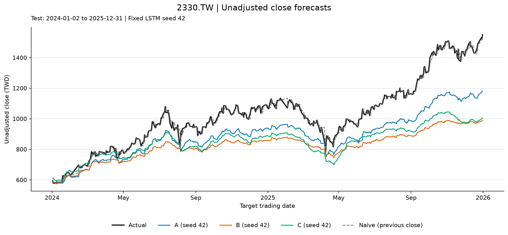
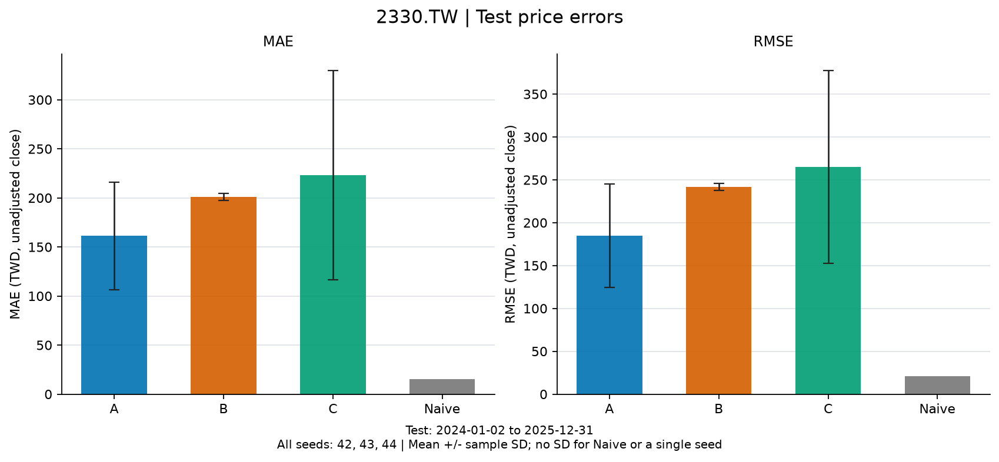
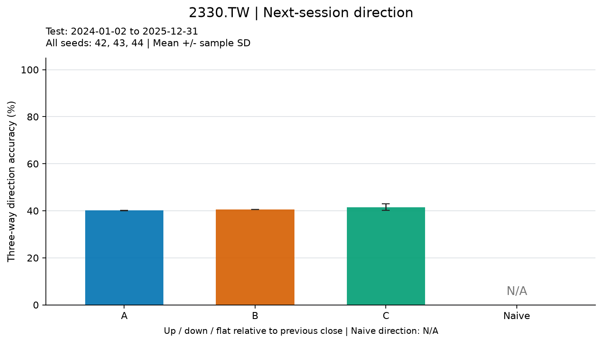
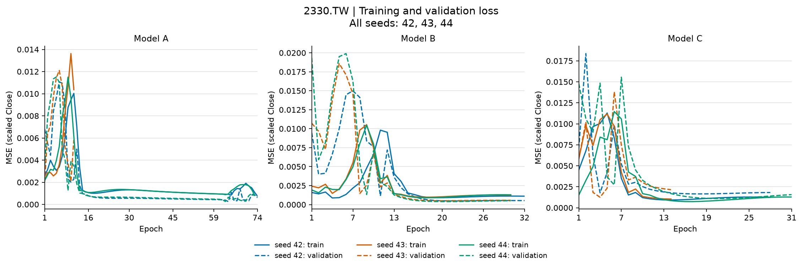

# 單變量與多變量 LSTM 股票價格預測比較｜實驗報告

## 一、本次實驗概況

本次設定符合正式研究預設，資料品質與正式實驗驗收仍須於 Commit 8 確認。 本報告自動整理保存產物，任何情況均不自動宣告 Commit 8 正式研究完成。

股票：2330.TW；設定資料期間：2015-01-01–2025-12-31；實際測試目標：2024-01-02–2025-12-31，共 485 筆。
種子：42, 43, 44；最大 epochs：100；各次實際 epochs 見下表。

## 二、資料與研究方法

來源：TWSE_STOCK_DAY，下載時間：2026-11-20T12:39:13.509858+00:00；價格口徑：未還原，保留來源成交量，不補週末或休市日。
使用過去 60 個交易日，預測下一交易日未還原 Close。未還原價格會保留除權息造成的價格跳空，結果代表名目收盤價預測，不等同含息報酬。技術指標採向後 MA、Wilder RSI14、SMA 初始化的 MACD 12/26/9；C 的 33 筆暖機與完整視窗決定共同日期。
依目標日期切分：train：2015-01-01–2022-12-31；validation：2023-01-01–2023-12-31；test：2024-01-01–2025-12-31。跨年度輸入保留已知歷史，X 僅以共同訓練輸入位置聯集擬合，y 僅以共同訓練目標擬合；測試只載回縮放器，不重新 fit、不裁切。
Naive 使用前一交易日 Close；方向以同一前收盤判斷上漲、下跌、持平，不加 epsilon；Naive 方向正確率為 N/A。

## 三、模型與訓練設定

三組共用單向 LSTM(64) → Dense(1)，Adam learning rate 0.001、MSE、batch size 32、shuffle=False、CPU。
早停只監看 val_loss，patience=10，還原最佳權重，不以 test 選種子或權重。輸入維度不同，參數量也不同，並非完全等參數比較。

| 組別 | 特徵 | 欄數 | 參數量 |
| --- | --- | --- | --- |
| A | Close | 1 | 16961 |
| B | Open、High、Low、Close、Volume | 5 | 17985 |
| C | Open、High、Low、Close、Volume、MA5、MA20、RSI14、MACD、MACD_signal | 10 | 19265 |

| 組別 | seed | 實際 epochs | 最佳 epoch |
| --- | --- | --- | --- |
| A | 42 | 74 | 64 |
| A | 43 | 11 | 1 |
| A | 44 | 73 | 63 |
| B | 42 | 32 | 22 |
| B | 43 | 30 | 20 |
| B | 44 | 30 | 20 |
| C | 42 | 28 | 18 |
| C | 43 | 14 | 4 |
| C | 44 | 31 | 21 |

## 四、逐種子與彙總績效

MAE 為主要比較指標；MAE／RMSE 單位：未還原價格（TWD）。方向正確率在 CSV 保存 0–1，本報告以百分比顯示。
彙總為算術平均與樣本標準差（ddof=1）；單種子 std 為 N/A。改善率為 100×(Naive誤差−模型誤差)/Naive誤差；負值表示變差，Naive 誤差為零時為 N/A。Naive 只有單份預測，種子數為 0。

| 組別 | seed | MAE | RMSE | 方向正確率（%） | MAE 改善（%） | RMSE 改善（%） |
| --- | --- | --- | --- | --- | --- | --- |
| A | 42 | 137.137 | 160.818 | 40.2062 | -792.173 | -666.922 |
| A | 43 | 224.186 | 253.752 | 40 | -1358.48 | -1110.11 |
| A | 44 | 122.737 | 140.621 | 40.2062 | -698.493 | -570.603 |
| B | 42 | 202.228 | 242.131 | 40.6186 | -1215.64 | -1054.69 |
| B | 43 | 203.921 | 246.051 | 40.6186 | -1226.65 | -1073.38 |
| B | 44 | 196.965 | 237.619 | 40.6186 | -1181.39 | -1033.17 |
| C | 42 | 177.324 | 218.711 | 41.8557 | -1053.62 | -943.003 |
| C | 43 | 345.315 | 393.521 | 40 | -2146.51 | -1776.65 |
| C | 44 | 147.598 | 183.036 | 42.6804 | -860.227 | -772.872 |
| Naive | N/A | 15.3711 | 20.9693 | N/A | N/A | N/A |

| 組別 | 種子數 | MAE 平均±樣本std | RMSE 平均±樣本std | 方向（%）平均±樣本std | MAE 改善（%） | RMSE 改善（%） |
| --- | --- | --- | --- | --- | --- | --- |
| A | 3 | 161.353 ± 54.8886 | 185.064 ± 60.3368 | 40.1375 ± 0.119041 | -949.717 | -782.545 |
| B | 3 | 201.038 ± 3.62746 | 241.934 ± 4.21967 | 40.6186 ± 0 | -1207.89 | -1053.75 |
| C | 3 | 223.412 ± 106.612 | 265.089 ± 112.647 | 41.512 ± 1.37285 | -1353.45 | -1164.18 |
| Naive | 0 | 15.3711（std N/A） | 20.9693（std N/A） | N/A | N/A | N/A |

## 五、研究圖表

價格圖固定 seed 42，不挑最佳 seed、不合成 ensemble。誤差與方向圖使用全部設定種子的平均及樣本 std；Naive 方向顯示 N/A。loss 圖顯示所有設定種子，單位為縮放後 Close 的 MSE，與原價 MAE／RMSE 不同。









## 六、依本次結果回答研究問題

**RQ1：OHLCV 與單變量比較：**B 平均 MAE 201.038 高於 A 的 161.353；逐種子為 1 次改善、0 次平手、2 次變差。不同種子的比較方向不一致。

**RQ2：技術指標的影響：**C 平均 MAE 223.412 高於 B 的 201.038；逐種子為 2 次改善、0 次平手、1 次變差。不同種子的比較方向不一致。

**RQ3：A 與 Naive：**平均 MAE 劣於 Naive；MAE 改善率 -949.717%，RMSE 改善率 -782.545%。逐種子有 0 次低於 Naive、0 次平手、3 次高於 Naive。

**RQ3：B 與 Naive：**平均 MAE 劣於 Naive；MAE 改善率 -1207.89%，RMSE 改善率 -1053.75%。逐種子有 0 次低於 Naive、0 次平手、3 次高於 Naive。

**RQ3：C 與 Naive：**平均 MAE 劣於 Naive；MAE 改善率 -1353.45%，RMSE 改善率 -1164.18%。逐種子有 0 次低於 Naive、0 次平手、3 次高於 Naive。

以上以平均 MAE 描述本次比較，RMSE 與方向結果另列於表格，沒有進行或宣稱統計顯著性檢定。觀察到的特徵影響不應推論為普遍因果關係。

## 七、研究限制

- 單一股票與固定期間，結果未必適用其他產業、市場或時期。
- 突發事件、基本面及其他未觀測因素未納入，歷史技術特徵不能保證未來預測能力。
- 行情可能修訂，來源缺日、價量品質及交易日曆正確性仍須查證；保存 metadata／hash 不等於資料品質已通過正式研究驗收。
- 僅有 3 個固定種子；有限次重複不代表統計顯著，單種子無法估計樣本標準差。
- 特徵欄數造成模型參數量差異，不能將差異全部歸因於特徵本身。
- 研究只衡量預測誤差，不等同投資報酬、交易策略績效或已完成回測。

## 八、重現與來源紀錄

行情 SHA256：`c431da778661ac0c247a9d91842538d498a85d701d7d243b6d51dfe813853646`；交易日 SHA256：`4fbf02495853afce74c647a0673136b5c74ebd612fb46d7cd1fb73e32f994965`。
設定 SHA256：`dbebf3b06b4a25f5c6a61e8a6a333c3e7349372cb2b137cef5a3624413c5896a`。訓練與評估環境見 [訓練環境](../environment.json)、[評估環境](../evaluation/environment.json)。
來源詳見 [設定](../config.json)、[metadata](../snapshot.metadata.json)、[逐種子績效](../evaluation/metrics_per_seed.csv)、[彙總績效](../evaluation/metrics_summary.csv)、[評估紀錄](../evaluation/evaluation.json)。
本次報告輸入與輸出 hash、產生環境及狀態保存於 [report.json](report.json)；權重／縮放器沿用評估保存的來源 hash 作追溯，本步驟不需重新載入原始行情、權重或 pickle。

```text
python -m lstm_comparison validate-config --config <設定檔>
python -m lstm_comparison download --config <設定檔>
python -m lstm_comparison run --config <設定檔>
python -m lstm_comparison evaluate --run-dir <實驗目錄>
python -m lstm_comparison report --run-dir <實驗目錄>
```

下載與正式訓練須另行執行並先滿足來源品質要求；本次產生報告沒有進行下載、訓練或重新評估。
